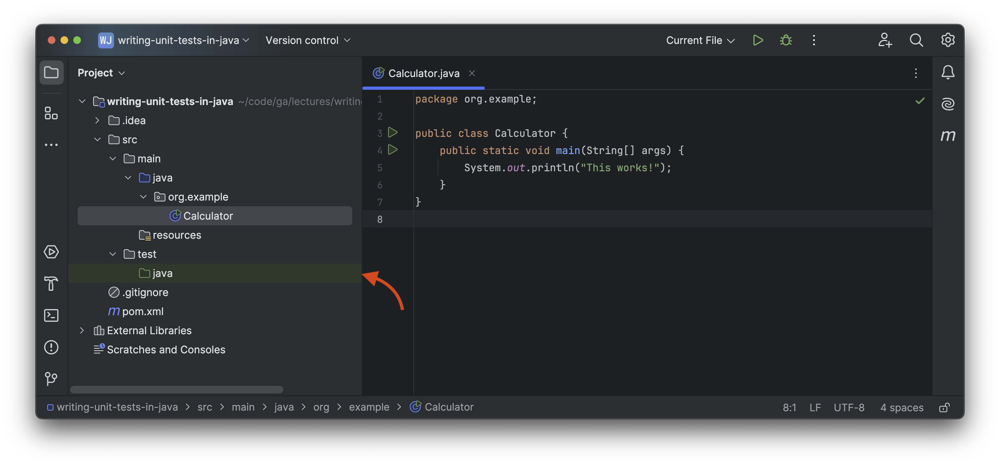
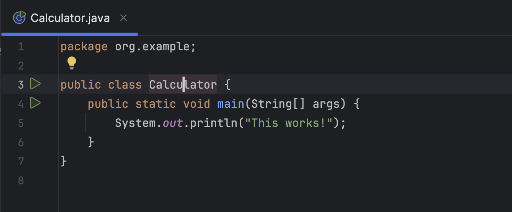
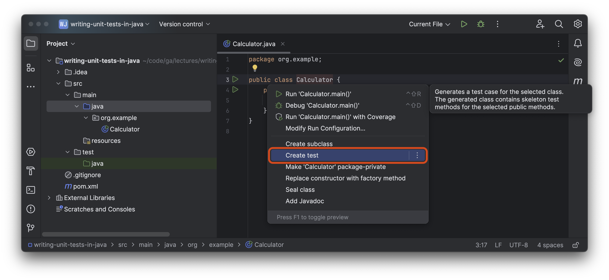
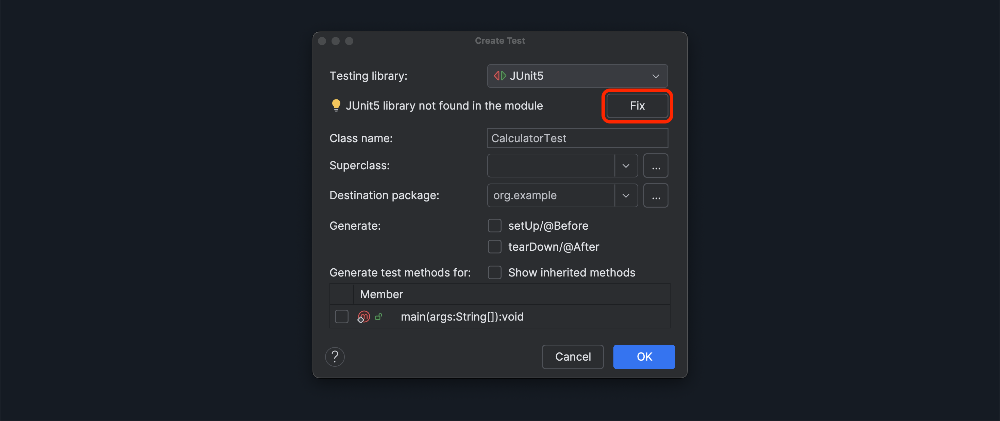
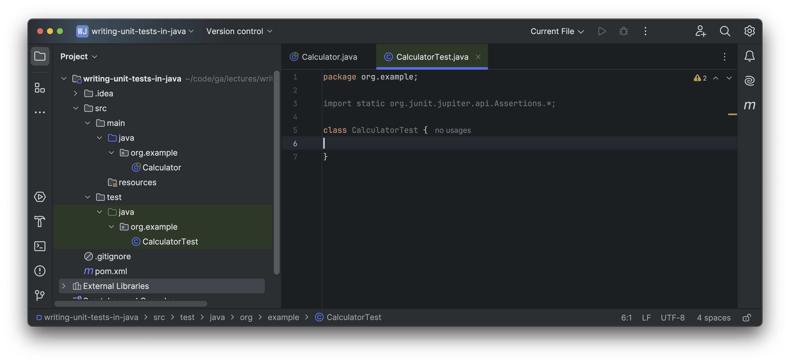

<h1>
  Writing Unit Tests in Java
  Creating a JUnit5 Test Class
</h1>

**Learning objective:** By the end of this lesson, you'll be able to create and setup a JUnit5 test class in IntelliJ IDEA IDE for any class that's part of your source code. 

## Creating a JUnit5 test class in IntelliJ IDEA IDE
In this module we'll learn how to create a JUnit5 test class that can be used to code automated tests that run on our `Calculator` class.

### Step 1

Open the <code class="filepath">src/test</code> directory in the Project tool window. Note the child <code class="filepath">java</code> directory icon is green and the directory has a green background.

   - This green directory icon indicates that the <code class="filepath">src/test/java</code> directory is the *Test Sources Root*. This directory will store our test code. This was automatically configured for us when we built our project using the Maven build system during our project setup. 

   - This is another example of the Maven convention in practice. Technically any directory could be the *Test Sources Root* by right clicking the chosen directory and selecting **Mark Directory As** > **Test Sources Root** , but there's no reason to break with the convention in this case. 

> 🧠 You may have noticed before that the <code class="filepath">src/main/java</code> directory's icon is blue, which indicates it is the *Sources Root*.

### Step 2
Open the <code class="filepath">src/main/java/org/example/Calculator.java</code> file. Click the `Calculator` class name so that the caret is somewhere inside the text and the `Calculator` text is highlighted in orange as shown outlined in the screenshot below.

With the caret here, use <kbd>⌥ Option</kbd> + <kbd>↩ Enter</kbd> (<kbd>Alt</kbd> + <kbd>Enter</kbd> in Windows and Linux) then select the **Create test** option shown outlined in red in the screenshot below.

### Step 3
A **Create Test** dialog box will appear. Create the new test with the below options:

- Select **JUnit5** as the testing library.
- The class name should be `CalculatorTest`.
- There is no superclass.
- The destination package should be `org.example`.
- Do not generate / generate test methods for.

We need to add the JUnit5 library to our project to use it. Once your **Create Test** dialog box looks like the one in the screenshot below, select the **Fix** button.

It might not look like anything is happening after you click this button, but in the background, the appropriate libraries should now be in your project.

After you've clicked the **Fix** button, click the blue **OK** button.

This will create a new `CalculatorTest` class in the <code class="filepath">src/test/java/org/example/CalculatorTest.java</code> file, ready for you to start writing tests in.

