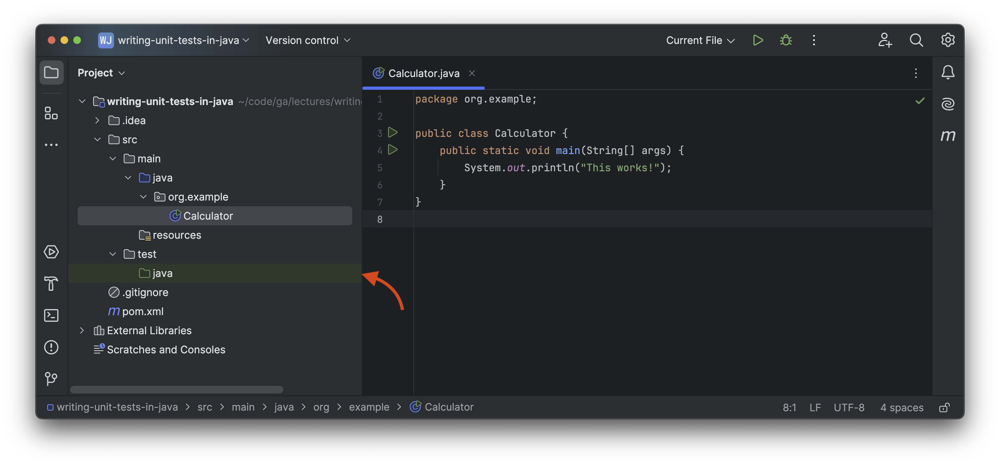
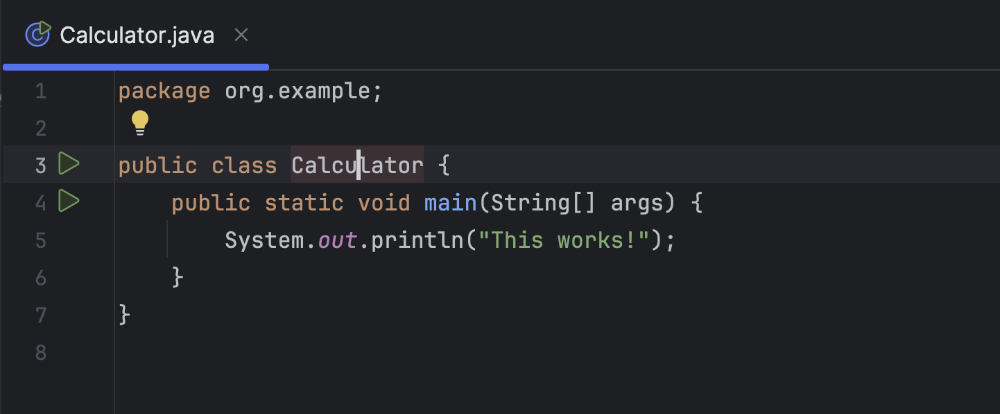
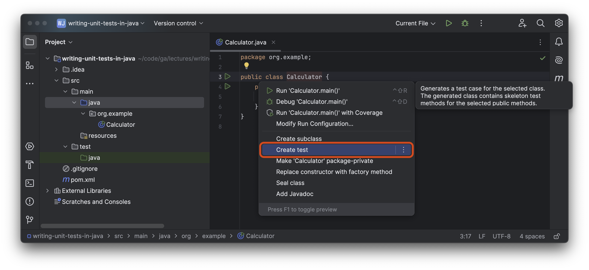
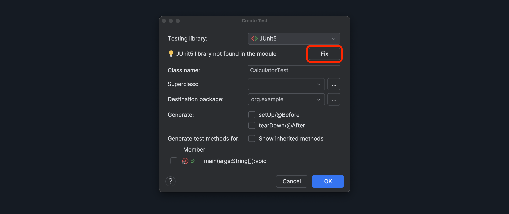
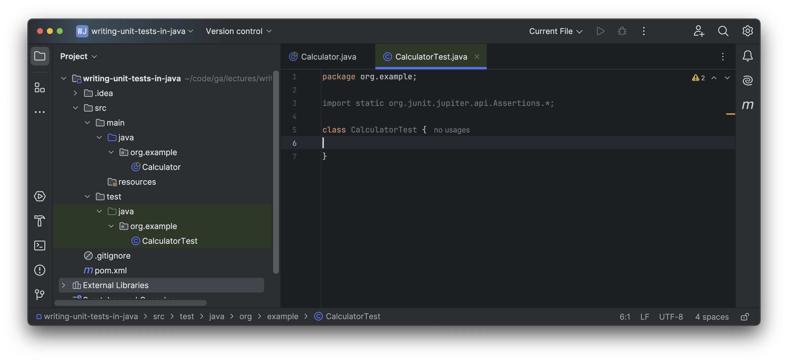

<h1>
  <span class="headline">Writing Unit Tests in Java</span>
  <span class="subhead">Intro and Creating a Unit Test Class</span>
</h1>

**Learning objective:** By the end of this lesson, students will be able to create a test class based off of another class, providing them with a place to write unit tests.

## Intro

In this module we'll create a basic calculator app, and write tests to confirm it functions as we intended.

## Creating a unit test

Open the <code class="filepath">src/test</code> directory in the Project tool window. Note the child <code class="filepath">java</code> directory icon is green and the directory has a green background.



This green directory icon indicates that the <code class="filepath">src/test/java</code> directory is the *Test Sources Root*. This directory will store our test code. This was automatically configured for us when we built our project using the Maven build system during our project setup. 

This is another example of the Maven convention in practice. Technically any directory could be the *Test Sources Root* by right clicking the chosen directory and selecting **Mark Directory As** > **Test Sources Root** , but there's no reason to break with the convention in this case. 

> 🧠 You may have noticed before that the <code class="filepath">src/main/java</code> directory's icon is blue, which indicates it is the *Sources Root*.

Open the <code class="filepath">src/main/java/org/example/Calculator.java</code> file. Click the `Calculator` class name so that the caret is somewhere inside the text and the `Calculator` text is highlighted in orange as shown outlined in the screenshot below.



With the caret here, use <kbd>⌥ Option</kbd> + <kbd>↩ Enter</kbd> (<kbd>Alt</kbd> + <kbd>Enter</kbd> in Windows and Linux) then select the **Create test** option shown outlined in red in the screenshot below.



A **Create Test** dialog box will appear. Create the new test with the below options:

- Select **JUnit5** as the testing library.
- The class name should be `CalculatorTest`.
- There is no superclass.
- The destination package should be `org.example`.
- Do not generate / generate test methods for.

We need to add the JUnit5 library to our project to use it. Once your **Create Test** dialog box looks like the one in the screenshot below, select the **Fix** button.

It might not look like anything is happening after you click this button, but in the background, the appropriate libraries should now be in your project.

After you've clicked the **Fix** button, click the blue **OK** button.



This will create a new `CalculatorTest` class in the <code class="filepath">src/test/java/org/example/CalculatorTest.java</code> file, ready for you to start writing tests in.



## Phase 1 (requirement definition)

We will take a simple example of a calculator application, and we will define the requirements based on the basic
features of a calculator. So as said earlier TDD starts with defining requirements in terms of tests. Let's refine our
first requirement in terms of tests.

- Create a simple String calculator with a method `int add(string numbers)`
- The method can take 0, 1 or 2 numbers, and will return their sum (for an empty string it will return `0`) for
  example `“”` or `1` or `1,2`
- Allow the `add` method to handle an unknown amount of numbers
- Allow the `add` method to handle new lines between numbers (instead of commas).
- The following input is ok: `1\n2,3` (will equal 6)
- Support different delimiters
- To change a delimiter, the beginning of the string will contain a separate line that looks like this: `//[delimiter]
  \n[numbers…]` for example `//;\n1;2` should return three where the default delimiter is `;`
- The first line is optional. All existing scenarios should still be supported
- Calling `add` with a negative number will throw an exception `negatives not allowed` – and the negative that was
  passed. If there are multiple negatives, show all of them in the exception message stop here if you are a beginner.
- Numbers bigger than `1000` should be ignored, so adding `2 + 1001` = 2

Even though this is a very simple program, just looking at those requirements can be overwhelming. Let’s take a
different approach. Forget what you just read and let us go through the requirements one by one.

<details>
<summary>Solution</summary>

Calculator.java

```java
public class Calculator {

    public int add(String numbers) {
        if (numbers.isEmpty()) {
            return 0;
        }

        String delimiter = ",|\n"; // default delimiters
        if (numbers.startsWith("//")) {
            int delimiterIndex = numbers.indexOf("\n");
            delimiter = numbers.substring(2, delimiterIndex);
            numbers = numbers.substring(delimiterIndex + 1);
            delimiter = delimiter.replace("[", "").replace("]", ""); // support for custom delimiters
            delimiter = java.util.regex.Pattern.quote(delimiter); // to handle special characters in regex
        }

        String[] tokens = numbers.split(delimiter);
        int sum = 0;
        List<Integer> negatives = new ArrayList<>();

        for (String token : tokens) {
            if (token.isEmpty()) {
                continue;
            }
            int number = Integer.parseInt(token.trim());
            if (number < 0) {
                negatives.add(number);
            } else if (number <= 1000) {
                sum += number;
            }
        }

        if (!negatives.isEmpty()) {
            throw new IllegalArgumentException("Negatives not allowed: " + negatives);
        }

        return sum;
    }
}
```

CalculatorTest.java

```java
import org.junit.jupiter.api.Test;
import static org.junit.jupiter.api.Assertions.*;

class CalculatorTest {

    private final Calculator calculator = new Calculator();

    @Test
    void testEmptyString() {
        assertEquals(0, calculator.add(""));
    }

    @Test
    void testOneNumber() {
        assertEquals(1, calculator.add("1"));
    }

    @Test
    void testTwoNumbers() {
        assertEquals(3, calculator.add("1,2"));
    }

    @Test
    void testMultipleNumbers() {
        assertEquals(6, calculator.add("1,2,3"));
    }

    @Test
    void testNewLineAsDelimiter() {
        assertEquals(6, calculator.add("1\n2,3"));
    }

    @Test
    void testDifferentDelimiters() {
        assertEquals(3, calculator.add("//;\n1;2"));
    }

    @Test
    void testNegativeNumber() {
        Exception exception = assertThrows(IllegalArgumentException.class, () -> {
            calculator.add("-1,2");
        });
        assertTrue(exception.getMessage().contains("Negatives not allowed"));
    }

    @Test
    void testNumbersBiggerThan1000() {
        assertEquals(2, calculator.add("2,1001"));
    }

    @Test
    void testMultipleNegatives() {
        Exception exception = assertThrows(IllegalArgumentException.class, () -> {
            calculator.add("2,-4,-5");
        });
        assertTrue(exception.getMessage().contains("-4") && exception.getMessage().contains("-5"));
    }
}
```
</details>